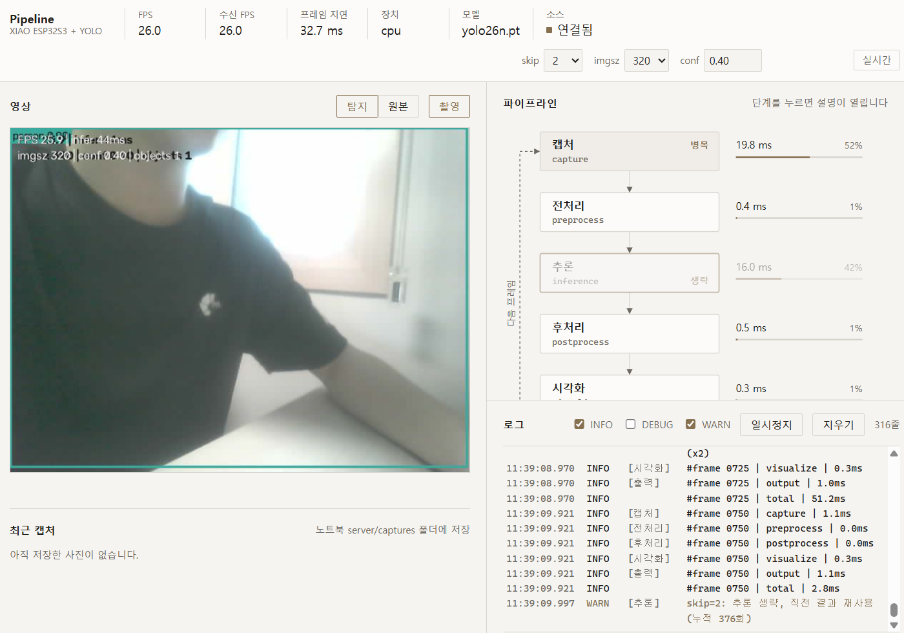
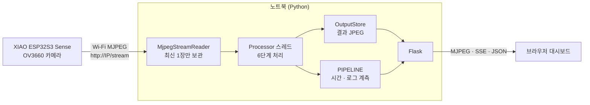

# XIAO ESP32S3 Sense × YOLO 파이프라인 대시보드

XIAO ESP32S3 Sense 카메라가 Wi-Fi 로 MJPEG 영상을 보내면, 노트북의 Flask 서버가 받아 YOLO 로 물체를 인식하고 브라우저 대시보드에 **영상 · 처리 단계 플로우차트 · 로그**를 실시간으로 보여 주는 1시간 실습 프로젝트입니다. SD 카드는 쓰지 않습니다.



---

## 목차
1. [전체 구조](#1-전체-구조)
2. [폴더 구조](#2-폴더-구조)
3. [준비물](#3-준비물)
4. [펌웨어 (ESP32)](#4-펌웨어-esp32)
5. [서버 (노트북)](#5-서버-노트북)
6. [대시보드 보는 법](#6-대시보드-보는-법)
7. [파이프라인 6단계](#7-파이프라인-6단계)
8. [실습 중 만난 문제와 해결](#8-실습-중-만난-문제와-해결)
9. [코드 작성 규칙](#9-코드-작성-규칙)

---

## 1. 전체 구조



| 구간 | 역할 |
|---|---|
| ESP32 포트 80 | `/` 안내 페이지, `/stream` MJPEG 스트림 |
| ESP32 포트 81 | `/status` 상태 JSON, `/capture` JPEG 1장 |
| 노트북 서버 | 스트림 수신 → YOLO 인식 → 결과 영상과 계측 데이터 제공 |
| 브라우저 | 영상, 플로우차트, 로그, 실행 중 설정 변경 |

> ESP32 의 HTTP 서버는 요청을 하나씩 처리하므로 **`/stream` 은 동시에 1명만** 볼 수 있습니다. 그래서 브라우저는 ESP32 에 직접 붙지 않고, 서버가 받은 영상을 다시 나눠 받습니다.

---

## 2. 폴더 구조

```
.
├── firmware/                      # ESP32 펌웨어 (PlatformIO)
│   ├── platformio.ini
│   └── src/
│       ├── main.cpp               # 카메라, Wi-Fi, HTTP 서버 2개
│       ├── camera_pins.h          # XIAO ESP32S3 Sense 카메라 핀
│       └── wifi_config.example.h  # 복사해서 wifi_config.h 로 사용
├── server/                        # 노트북 서버 (Python)
│   ├── config.py                  # 설정 (환경변수 우선)
│   ├── pipeline.py                # 단계별 계측 모듈
│   ├── step8_pipeline_dashboard.py# 메인 서버
│   ├── requirements.txt
│   ├── templates/dashboard.html
│   └── static/dashboard.js, dashboard.css
└── docs/images/dashboard.png
```

---

## 3. 준비물

| 구분 | 내용 |
|---|---|
| 보드 | Seeed Studio XIAO ESP32S3 Sense (8MB PSRAM, OV2640 또는 OV3660) |
| 개발 도구 | VS Code + PlatformIO |
| 파이썬 | Python 3.10 이상 |
| 네트워크 | 보드와 노트북이 **같은 2.4GHz Wi-Fi** 에 연결 |

---

## 4. 펌웨어 (ESP32)

### 4-1. Wi-Fi 설정
`firmware/src/wifi_config.example.h` 를 같은 폴더에 `wifi_config.h` 로 복사하고 값을 채웁니다.

```c
#define WIFI_SSID      "내_와이파이_이름"
#define WIFI_PASSWORD  "비밀번호"
#define CAMERA_FRAME_SIZE   FRAMESIZE_VGA   // 640x480
#define CAMERA_JPEG_QUALITY 12              // 0~63, 작을수록 고화질
```

`wifi_config.h` 는 `.gitignore` 에 들어 있어 비밀번호가 저장소에 올라가지 않습니다.

### 4-2. 주요 설정 (`platformio.ini`)
- `platform = espressif32 @ 8.0.0` 으로 버전 고정 (Arduino 코어 3.3.x)
- `board_build.arduino.memory_type = qio_opi` : 8MB Octal PSRAM 사용
- `-DBOARD_HAS_PSRAM -DARDUINO_USB_MODE=1 -DARDUINO_USB_CDC_ON_BOOT=1`
- **esp32-camera 를 `lib_deps` 에 넣지 않습니다.** Arduino 코어에 이미 들어 있어 중복 링크 오류가 납니다.
- `build_dir = C:/pio_build/xiao_cam` : 프로젝트 경로에 한글이 있을 때 링크 오류를 피하기 위한 설정입니다. macOS / Linux 에서는 지웁니다.

### 4-3. 업로드
1. USB-C 로 보드를 연결하고 PlatformIO 의 **Upload(→)** 를 누릅니다.
2. 포트를 찾지 못하면 **BOOT 버튼을 누른 채 RESET 을 눌렀다 떼고**, BOOT 에서 손을 뗀 뒤 다시 업로드합니다.
3. 업로드 후 **RESET 을 한 번** 눌러 새 펌웨어를 실행합니다.
4. 시리얼 모니터(115200bps)에서 접속 주소를 확인합니다.

```
[BOOT] XIAO ESP32S3 Sense MJPEG streamer
[CAM] sensor PID 0x3660
[CAM] 초기화 완료  VGA, 버퍼 2장
[WIFI] 연결됨  IP 192.168.45.60  RSSI -67 dBm
========================================
 스트림    : http://192.168.45.60/stream
 상태      : http://192.168.45.60:81/status
 사진      : http://192.168.45.60:81/capture
 주의      : /stream 은 동시에 1명만 볼 수 있습니다.
========================================
[STAT] stream 25.0 fps | 13.7 KB/frame | clients 1 | RSSI -67 dBm
```

### 4-4. 펌웨어가 하는 일
- **카메라** : JPEG 모드, `CAMERA_GRAB_LATEST`, 프레임 버퍼 2장을 PSRAM 에 둡니다. PSRAM 이 없으면 QVGA · DRAM · 버퍼 1장으로 낮춥니다.
- **Wi-Fi** : 절전 끔(`WiFi.setSleep(false)`), 접속 시간 제한, 끊기면 `loop` 에서 재접속
- **HTTP** : `esp_http_server` 로 포트 80(스트림)과 81(상태)을 따로 띄워, 스트림이 80 을 점유해도 81 로 상태를 볼 수 있습니다.
- **MJPEG** : `multipart/x-mixed-replace` 로 프레임마다 `Content-Type`, `Content-Length`, `X-Timestamp` 헤더를 붙입니다.
- **통계** : 5초마다 FPS, 평균 KB/frame, 클라이언트 수를 시리얼에 출력하고 `/status` 로도 제공합니다.

---

## 5. 서버 (노트북)

### 5-1. 설치
```bash
cd server
pip install -r requirements.txt
```
처음 실행할 때 `yolo26n.pt` 모델이 자동으로 내려받아집니다. 불러오지 못하면 `yolo11n.pt` 로 대체합니다.

### 5-2. 실행
```bash
# CPU + YOLO
python step8_pipeline_dashboard.py --url http://192.168.45.60/stream --log-every 25

# YOLO 없이 무선 지연만 관찰 (보드 세팅 확인용)
python step8_pipeline_dashboard.py --url http://192.168.45.60/stream --no-yolo

# NVIDIA GPU (CUDA 를 쓸 수 없으면 경고 후 CPU 로 실행)
python step8_pipeline_dashboard.py --url http://192.168.45.60/stream --device cuda:0 --imgsz 640 --skip 1

# 보드 없이 노트북 웹캠으로 연습
python step8_pipeline_dashboard.py --source webcam
```
브라우저에서 **http://127.0.0.1:5000** 을 엽니다. 종료는 터미널에서 **Ctrl+C** 입니다.

### 5-3. 주요 옵션
| 옵션 | 기본값 | 설명 |
|---|---|---|
| `--url` | `http://192.168.0.50/stream` | ESP32 스트림 주소 (환경변수 `CAMERA_URL` 로도 지정) |
| `--source` | `esp32` | `esp32` 또는 `webcam` |
| `--device` | `cpu` | `cpu`, `cuda`, `cuda:0`, `mps` |
| `--imgsz` | `320` | 추론 입력 크기 (32의 배수) |
| `--conf` | `0.4` | 신뢰도 임계값 |
| `--skip` | `2` | 몇 프레임마다 한 번 추론할지 |
| `--classes` | 전체 | 예: `person,cup` 또는 `0,41` |
| `--no-yolo` | - | 추론을 끄고 수신과 표시만 |
| `--log-every` | `5` | INFO · DEBUG 로그를 남기는 프레임 간격 |

### 5-4. 서버 API
| 메서드 | 경로 | 설명 |
|---|---|---|
| GET | `/` | 대시보드 |
| GET | `/detect_feed`, `/raw_feed` | 탐지 결과 / 원본 MJPEG |
| GET | `/api/pipeline` | 단계 설명(docstring)과 현재 계측 상태 |
| GET | `/api/config` | 적용된 설정 |
| POST | `/api/settings` | `skip`, `imgsz`, `conf` 실행 중 변경 (값 검증) |
| GET | `/events` | SSE, 200ms 마다 상태 전송 |
| POST | `/capture` | 현재 화면을 `server/captures/` 에 저장 |
| GET | `/api/captures`, `/captures/<파일>` | 캡처 목록 / 파일 |

---

## 6. 대시보드 보는 법

위 스크린샷은 실제 보드(OV3660, VGA)와 노트북 CPU 로 실행한 화면입니다.

### 상단 바
| 항목 | 스크린샷 값 | 의미 |
|---|---|---|
| FPS | 26.0 | 서버가 처리를 끝낸 초당 프레임 수 |
| 수신 FPS | 26.0 | ESP32 에서 받은 초당 프레임 수 |
| 프레임 지연 | 32.7 ms | 받은 뒤 결과 화면이 만들어질 때까지 걸린 시간 |
| 장치 / 모델 | cpu / yolo26n.pt | 추론 장치와 실제로 불러온 모델 |
| 소스 | 연결됨 | ESP32 스트림 연결 상태 |

오른쪽의 `skip`, `imgsz`, `conf` 를 바꾸면 서버를 다시 켜지 않고 바로 적용됩니다. 대시보드와 서버의 연결이 끊기면 오른쪽 끝에 **재연결 중** 이 표시됩니다.

### 영상 (왼쪽)
- **탐지 / 원본** : 상자가 그려진 결과와 ESP32 원본을 전환합니다.
- 영상 위 글자 : `FPS 25.9 | infer 44ms`, `imgsz 320 | conf 0.40 | objects 1`
- 스크린샷에서는 사람(`person`)이 검출되어 강조색 테두리가 그려져 있습니다.
- **촬영** : 현재 화면을 노트북에 저장하고, 아래에 최근 캡처 10장을 보여 줍니다.

### 파이프라인 플로우차트 (오른쪽 위)
- 캡처 → 전처리 → 추론 → 후처리 → 시각화 → 출력, 그리고 출력에서 캡처로 돌아가는 **다음 프레임** 점선
- 각 단계 오른쪽에 **프레임당 평균 ms** 와 **비중 막대**
- 가장 오래 걸리는 단계에 **병목** 표시, 지금 실행 중인 단계는 강조색 테두리
- `skip` 으로 추론을 건너뛴 프레임은 추론 노드가 흐려지고 **생략** 표시
- 단계를 누르면 그 함수의 docstring(요약, 입력, 출력, 왜 필요한가, 매개변수)과 실행 시 평균 시간이 열립니다.

> **스크린샷 해석**
> 캡처가 52% 로 병목입니다. 캡처 시간에는 *새 프레임을 기다린 시간*이 포함되므로, 컴퓨터가 아니라 **Wi-Fi 로 영상이 오는 속도**가 전체 속도를 정하고 있다는 뜻입니다. 추론의 프레임당 평균은 16.0ms 인데, skip=2 라서 두 프레임에 한 번만 실행하므로 한 번 실행할 때는 그 두 배쯤 걸립니다. 그래도 CPU 로 카메라 속도(26 FPS)를 따라가고 있습니다.

### 로그 (오른쪽 아래)
- 고정폭 글꼴, 최신이 아래. 바닥을 보고 있을 때만 자동 스크롤
- `INFO` : 단계 통과 시간 (`#frame 0750 | capture | 1.1ms`)
- `DEBUG` : 입출력 모양 (`in=(480,640,3) uint8 out=1 boxes`), 기본은 숨김
- `WARN` : 프레임 드롭, skip 으로 추론 생략, 예외
- **일시정지** 중에 온 로그는 모아 두었다가 재개할 때 한꺼번에 붙입니다. 화면에는 최근 400줄만 유지합니다.

---

## 7. 파이프라인 6단계

각 단계는 `@stage("이름")` 데코레이터가 붙은 함수 하나입니다. 데코레이터가 실행 시간과 입출력 모양을 자동으로 기록합니다.

| 단계 | 함수 | 하는 일 | 왜 필요한가 |
|---|---|---|---|
| 캡처 | `capture_frame` | 최신 JPEG 를 꺼내 디코딩 | 압축된 JPEG 바이트는 픽셀 계산을 할 수 없어 숫자 배열로 풀어야 합니다. 대기 시간이 포함되므로 이 단계가 병목이면 무선 전송이 느린 것입니다. |
| 전처리 | `preprocess` | BGR uint8 로 통일, 너무 넓으면 축소 | 카메라마다 다른 형식을 모델이 받는 형식 하나로 맞춥니다. |
| 추론 | `run_inference` | YOLO 실행, skip 이면 생략 | ultralytics 가 잰 전처리 · 추론 · 후처리 시간을 나눠 기록해 신경망 자체의 시간을 따로 보여 줍니다. |
| 후처리 | `postprocess` | 결과를 `Detection` 목록으로 변환 | 텐서를 정수 좌표와 클래스 이름으로 바꿉니다. 생략된 프레임은 직전 결과를 재사용합니다. |
| 시각화 | `visualize` | 상자, 이름, 신뢰도, 상태 문구 그리기 | 숫자 목록 대신 사람이 바로 확인할 수 있게 합니다. |
| 출력 | `output` | JPEG 로 압축해 보관소에 저장 | 여러 브라우저가 같은 결과를 나눠 볼 수 있게 합니다. |

`pipeline.py` 의 `PIPELINE` 객체는 프레임마다 `begin_frame → 6단계 → end_frame` 을 묶어 단계별 최근 30프레임 평균, 비중, 병목, FPS 를 계산하고, 로그를 링버퍼(500줄)에 보관합니다.

---

## 8. 실습 중 만난 문제와 해결

| 증상 | 원인 | 해결 |
|---|---|---|
| 링크 단계에서 `cannot open map file` | 프로젝트 경로의 한글 · 공백(`바탕 화면`)을 링커가 처리하지 못함 | `platformio.ini` 에 `build_dir = C:/pio_build/xiao_cam` 지정, 또는 프로젝트를 영문 경로로 이동 |
| 업로드는 됐는데 영상이 안 나오고 `cam_hal: FB-OVF` 반복 | `camera_config_t` 를 0 으로 초기화하지 않아 `jpeg_buffer_size` 에 쓰레기 값이 들어감 → 버퍼 크기가 엉뚱하게 잡혀 모든 프레임이 버려짐 | `memset(&config, 0, sizeof(config))` 후 `jpeg_buffer_size = 256KB` 명시 |
| 서버가 `스트림 연결 실패: timed out` 반복 | ESP32 스트림은 1명만 볼 수 있는데 다른 서버나 브라우저가 이미 연결됨 | 다른 연결을 끊기. 서버를 강제 종료한 직후라면 보드가 약 1분간 묶일 수 있어 잠시 기다림 |
| 매 프레임 `'half' is deprecated` 경고 | 최신 ultralytics 는 `half` 대신 `quantize` 사용 | 설치된 버전을 확인해 GPU 에서만 `quantize=16` (구버전은 `half=True`) 전달 |
| torch DLL 로드 실패 (WinError 4551) | Windows 앱 제어 정책 | ultralytics 를 모델 로드 시점에만 불러오고, 실패해도 서버는 추론 없이 계속 실행. `--no-yolo` 는 torch 를 읽지 않음 |
| 영상 위 FPS 가 실제보다 높게 표시 | FPS 값 자체를 평균하면 짧은 간격이 과대 반영됨 | 프레임 간격을 평균한 뒤 역수를 취함 |

---

## 9. 코드 작성 규칙

- **Python** : 모든 함수 · 클래스(중첩 함수, Flask 라우트 포함)에 XML docstring 을 씁니다. 이 docstring 이 그대로 대시보드 상세 패널의 설명이 됩니다.
  ```python
  @stage("preprocess")
  def preprocess(image, max_width):
      """
      <summary>이미지를 3채널 BGR uint8 로 맞추고, 너무 넓으면 줄인다.</summary>
      <param name="image">디코딩된 이미지</param>
      <param name="max_width">허용하는 최대 가로 픽셀 수</param>
      <input>캡처 단계의 이미지 배열</input>
      <output>모델이 바로 쓸 수 있는 BGR uint8 이미지</output>
      <reason>카메라마다 다른 형식을 여기서 한 번 통일해 둔다.</reason>
      """
  ```
  docstring 은 XML 로 파싱되므로 본문에 `<` 와 `&` 를 쓰지 않습니다.
- **C++** : 함수마다 `/// <summary>`, `<param>`, `<returns>`, `<reason>` 주석
- **JavaScript** : 함수마다 `/** <summary> <param> <returns> */` 주석
- 모든 언어에서 중괄호를 생략하지 않고, 여는 중괄호 뒤는 줄바꿈합니다.
- **디자인** : 무채색 바탕 + 채도 낮은 브론즈 강조색 1개, 1px 선과 여백, 외부 라이브러리 · CDN 없음 (강의실 오프라인에서도 동작)
